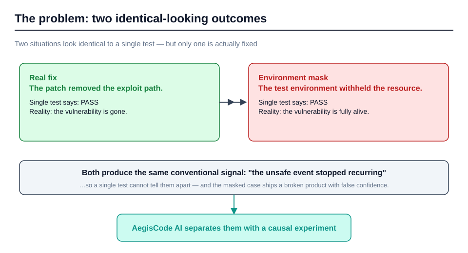
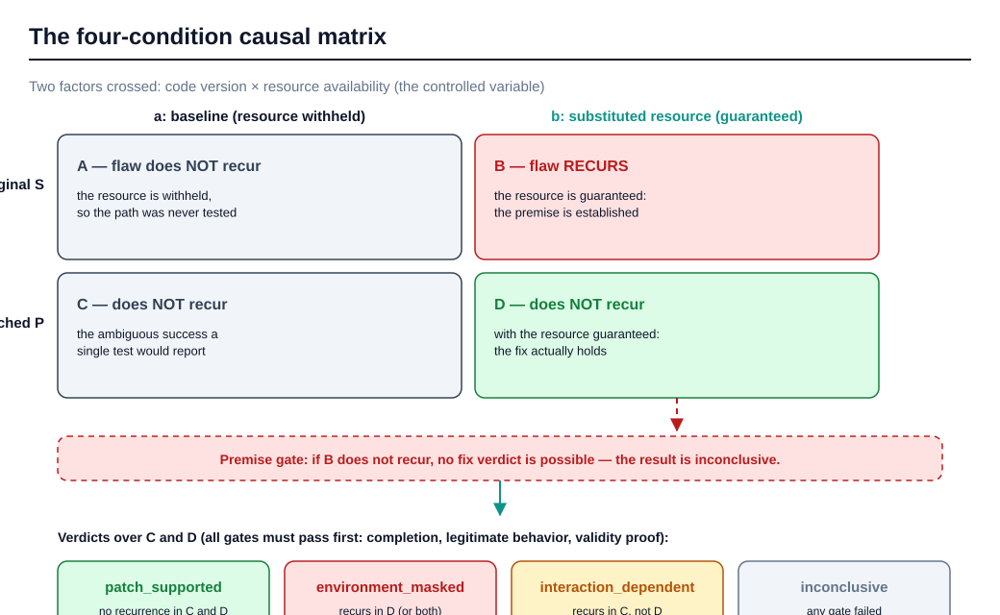
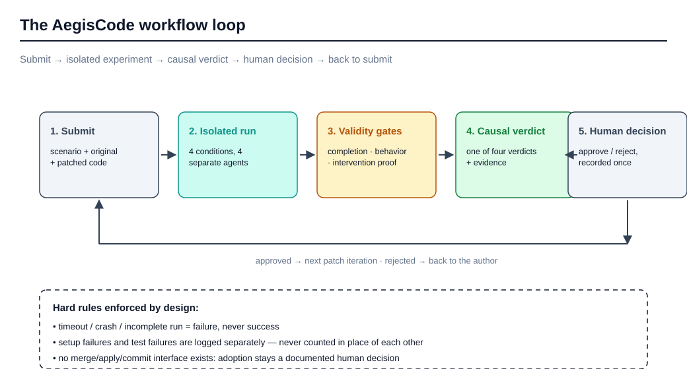
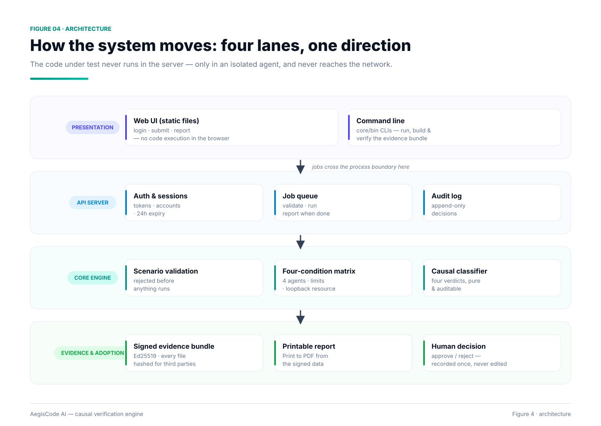
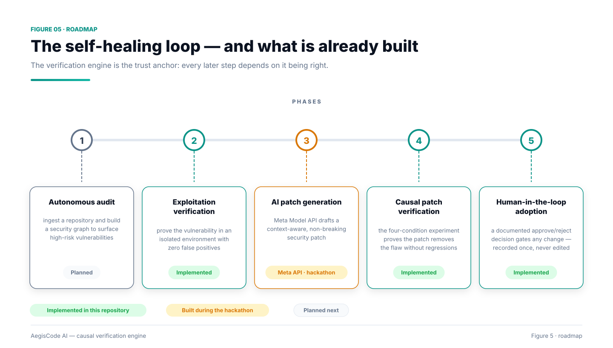

# AegisCode AI

**Autonomous Cyber-Vulnerability Detection & Self-Healing Agent**

> Did the patch really fix the flaw — or did the test environment merely mask it?

Built for the **Meta Global AI Developer Hackathon** (Cerebral Valley).

---

## Overview

AegisCode AI is a closed-loop security verification engine. Unlike traditional
scanners that only flag issues, AegisCode AI **proves** whether a candidate
security patch actually works — by running a controlled causal experiment,
not a single test:

| Situation | What the tester sees | Technical reality |
|---|---|---|
| A real fix | "the unsafe event disappeared" | the vulnerability was truly removed from the code |
| An environment mask | "the unsafe event disappeared" | the environment withheld the resource, so the path was never exercised |

The difference between the two is the difference between a **safe product** and
a **compromised product** shipped with false confidence.

---

## The core principle

Instead of running the patch once and declaring success, the engine runs
**four conditions** crossed between two factors:

| | **Environment a: baseline** | **Environment b: substituted synthetic resource** |
|---|---|---|
| **Original version S** | **A** — the flaw recurs | **B** — the flaw recurs with the resource available |
| **Patched version P** | **C** — no recurrence (ambiguous) | **D** — no recurrence despite the resource available |

A **fixed external security policy** holds across all experiments, and an
**intervention-validity gate** blocks any "real fix" verdict unless the
intervention is proven to have actually executed.

### The four verdicts

| Verdict | Meaning |
|---|---|
| `patch_supported` | Patch supported — the flaw did not recur even with the resource available |
| `environment_masked` | Environment masked — the success came from the environment, not the patch |
| `interaction_dependent` | Interaction dependent — the effect changes with the environment |
| `inconclusive` | Inconclusive — intervention validity or run completion could not be confirmed |

**Strict rule:** `timeout` or `crash` or an incomplete run = **failure, never
success**.

---

## The reference experiment

The reference run executes a **real patch** and a **fake patch** that produce
**the same conventional test result** ("the event did not recur") — and the
engine issues a fundamentally different verdict for each:

| Patch | What the conventional test says | Causal verdict |
|---|---|---|
| real | success | `patch_supported` |
| fake | success | `environment_masked` — **the vulnerability remains** |

That difference is what prevents an unsafe patch from being adopted with false
confidence.

---

## Figures

| Figure | What it shows |
|---|---|
|  | The problem: two identical-looking outcomes |
|  | The four-condition causal matrix and verdicts |
|  | The end-to-end workflow loop |
|  | The architecture: four lanes, one direction |
|  | The self-healing loop and what is already built |

Regenerate them (zero dependencies, plain SVG output):

```bash
node tools/gen-diagrams.js
```

---

## Running the engine

Everything below runs with **zero external dependencies** — Node ≥ 20 only.

```bash
# Core engine (53 tests)
cd core
node --test

# A real verification run
mkdir -p ../build
node bin/aegiscode.js \
  --scenario scenarios/demo-template-fetch.json \
  --original fixtures/original --patched fixtures/patch-real \
  --json ../build/report.json --out ../build/report.md

# Server + web UI (14 more tests in server/)
cd ../server && node --test

# Signed evidence bundle for a third party + verifying it (from core/)
cd ../core
node bin/aegiscode-evidence.js build --report-json ../build/report.json \
  --report-md ../build/report.md --scenario scenarios/demo-template-fetch.json \
  --repo .. --out ../build/evidence
node bin/aegiscode-evidence.js verify --bundle ../build/evidence --repo ..
```

### Run the full server + web UI

```bash
AEGISCODE_API_TOKENS="dev-token-1234" node server/bin/aegiscode-server.js --port 8080
# UI:   http://127.0.0.1:8080/
# API:  http://127.0.0.1:8080/api/health
```

Or with Docker:

```bash
AEGISCODE_API_TOKENS="token1,token2" docker compose up -d
```

---

## Repository layout

| Path | What it is |
|---|---|
| `core/` | The causal verification engine — zero external dependencies |
| `core/src/matrix.js` | The four-condition matrix runner over a separate execution agent |
| `core/src/classify.js` | The causal classifier: the four verdicts, pure and auditable |
| `core/src/resource.js` | The synthetic loopback resource + the intervention-validity gate |
| `core/src/evidence.js` | Guarantee map → code → test, Ed25519-signed evidence bundle |
| `server/` | API server: job queue, accounts, sessions, audit log |
| `server/src/meta-*.js`, `budget.js`, `advisory.js` | Meta advisory integration + central spending controls (hackathon-added) |
| `server/bin/aegiscode-readiness.js` | Local readiness check: liveness, auth, demo-safe Meta state (no spend) |
| `server/bin/aegiscode-demo-reset.js` | Demo reset: clears jobs/advisories, preserves budget, accounts, audit |
| `web/` | The web UI (static files, no code execution) |
| `core/fixtures/` | Experiment code: original / real patch / fake patch / hang |
| `docs/16-demo-and-submission-en.md` | Demo ops, 2–3 min script, submission checklist, work-attribution table |

---

## What makes it trustworthy

- **Execution isolation**: the code under test never runs in the server or
  coordinator process — only in a separate agent's child process, in a clean
  deleted-after-use workspace, with memory/output/time limits and an
  environment allowlist.
- **Network isolation**: `unshare` network namespaces when available; when not,
  the report says so explicitly with the reason — isolation is never
  overclaimed, and the synthetic resource is loopback-only regardless.
- **Evidence before verdicts**: the intervention-validity gate must be passed
  before any fix verdict; setup failures are logged separately from test
  failures.
- **Human adoption only**: the system emits the verdict and the evidence. There
  is no merge/apply/commit interface — adoption is a documented human decision,
  recorded once with a name and a reason.
- **Third-party verifiable**: the evidence bundle is signed Ed25519 with every
  file hashed; anyone can verify it on any machine with Node, no trust in us
  required.

---

## Roadmap: the self-healing loop

The verification engine is the trust anchor of the full autonomous loop:

1. **Autonomous audit** — ingest a repository and build a security graph to
   surface high-risk vulnerabilities.
2. **Sandbox exploitation verification** — prove the vulnerability in an
   isolated environment with zero false positives. **(implemented — this repo)**
3. **AI patch generation** — Meta's Llama models draft a context-aware,
   non-breaking security patch for the verified flaw.
4. **Causal patch verification** — the four-condition experiment proves the
   generated patch actually removes the flaw without regressions.
   **(implemented — this repo)**
5. **Human-in-the-loop adoption** — a documented approve/reject decision gates
   any change. **(implemented — this repo)**

Steps 3 and beyond integrate with the Meta Model API during the hackathon.

---

## Meta Model API advisory (hackathon integration)

One end-to-end workflow is powered by the Meta Model API — and only one:

1. **Explain** the verified finding, using the submitted code and the stored evidence.
2. **Propose** a candidate patch (advisory only — never applied, never merged).
3. **Verify** the candidate in the independent four-condition harness — unchanged.
4. **Summarize** the observed harness results and the remaining limitations.

The model's role is advisory in every stage: it never decides a verdict, and
`core/` — the matrix, the classifier, the executor, the isolation and every
assertion — is untouched by this integration. The candidate is untrusted
code: it runs only inside the existing isolation boundary (separate agent,
clean workspace, limits), and if the harness refuses it, the pipeline refuses
with it. There is still no apply/merge/commit interface of any kind.

### Model and pricing

| | |
|---|---|
| Model | `muse-spark-1.3` (standard mode) |
| Endpoint | `https://api.meta.ai/v1/chat/completions` (Bearer key) |
| Pricing | $1.25 / 1M input tokens · $4.25 / 1M output tokens |
| Source | [dev.meta.ai/docs/pricing-rate-limits](https://dev.meta.ai/docs/pricing-rate-limits) — verified 2026-10-26 |

Standard mode is used rather than the cheaper Contributor mode, because
Contributor mode permits Meta to use submitted content for training. Whether
the **free-credit** terms (the dashboard warns that content may be used for
product improvement while free credits are in use) differ from standard
billing is **not resolved in Meta's public documentation** and is flagged here
as requiring confirmation — this project makes no claim either way.

### Integration states — an API key alone never means "working"

| State | Meaning |
|---|---|
| `mock` | Default. No key, no network, outputs carry a visible `[mock output — …]` marker. |
| `live_disabled` | `META_MODE=live` without `META_API_KEY`: the advisory refuses and **never** falls back to mock output. |
| `live_configured` | A key is present. Not proof of connectivity. |
| `live_verified` | At least one real call succeeded (persisted). |

> **Live access verified 2026-10-27:** the stored key authenticates
> (`muse-spark-1.3`, playground reply `SMOKE_OK`, no payment method required).
> API response-shape diagnosis pending — project spend so far: $0.00.

### Spending controls (all live calls pass through one budget manager)

- Approved ceilings: **$10 total · $5/day · $2 per job by default · $3 absolute**.
  A "job" is the whole cycle (explain + patch + summarize) — splitting it
  cannot bypass the cap. Ceilings are never auto-reset or auto-increased.
- Before the first call: a conservative **$0.05 per-cycle reservation** is
  taken atomically (input estimated conservatively, output capped with
  `max_completion_tokens`, zero automatic retries). Insufficient budget ⇒
  the call is rejected with an explicit code, never attempted.
- After the cycle: the reservation is reconciled with the provider-reported
  usage (`usage.prompt_tokens` / `usage.completion_tokens`); costs stay marked
  *estimated* until provider billing confirms. Uncertain usage stays reserved.
- **One active live job at a time.** Accounting persists in
  `data/meta-budget.json` (atomic writes, auditable by hand).

### Configuration (server-side only — never committed, never sent to the browser)

| Variable | Default | Meaning |
|---|---|---|
| `META_MODE` | `mock` | `mock` or `live`. |
| `META_API_KEY` | — | The Meta API key (`LLM_…`), entered privately in the server's environment. |
| `META_MODEL_ID` | `muse-spark-1.3` | Model override (no silent switching happens at runtime). |
| `META_BASE_URL` | `https://api.meta.ai/v1` | Endpoint override for testing. |

### Offline tests

`server/test/meta.test.js` (12 tests) and `server/test/budget.test.js` (8
tests) cover the four states, the refusal-to-fallback rule, request shape,
ceilings, single-attempt behaviour, the full mock cycle through the real
harness, the live accounting path with an **injected fetch stub** (no network),
budget persistence, exhaustion and the one-live-job rule. Nothing in the
test suite makes a live call.

## License

MIT
